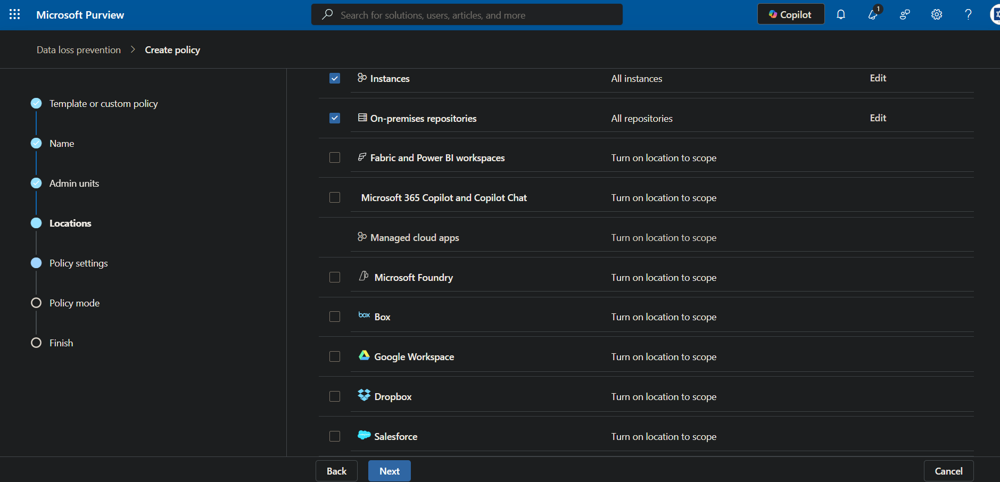

# Evidências — o que verificar e onde

Este documento lista as evidências que comprovam cada camada do laboratório
funcionando. A ideia é que você valide **no seu próprio tenant**, não que
confie em capturas de tela de outro ambiente.

Cada seção diz onde olhar, o que deve aparecer e quanto tempo costuma levar
para a evidência surgir.

---

## 1. A identidade do agente autentica

**Onde:** Microsoft Entra ID → Monitoring → Sign-in logs → aba *Service
principal sign-ins*

**Filtro:** pelo Application ID da identidade do agente.

**O que deve aparecer:** uma entrada de sucesso a cada execução do agente, com
o recurso sendo a API de observabilidade do Agent 365.

**Prazo:** imediato, com alguns minutos de atraso na indexação.

Se não aparecer nada, o problema está na cadeia `fmi_path` — veja a seção
*Como a autenticação funciona* no README.

---

## 2. A telemetria chega ao Agent 365

**Onde:** Microsoft 365 Admin Center → Agentes → o seu agente

**O que deve aparecer:** o agente registrado, com identidade Entra associada e
as proteções do Purview listadas na aba de segurança.

**Prazo:** cerca de uma hora após o registro.

Atenção: a exportação de spans retornar HTTP 200 **não** significa que a
atividade será elegível. Sem `microsoft.channel.name`, `microsoft.session.id`,
a operação `output_messages` e o `record_response()` na ferramenta, os spans
existem e nada aparece. É uma falha silenciosa — veja a seção *Telemetria
elegivel para o Microsoft Defender* no README.

---

## 3. O agente aparece no inventário do Defender

**Onde:** Microsoft Defender → Assets → AI agents

**O que deve aparecer:** uma linha com o nome do agente, correlacionando os
identificadores — `SourceAgentId`, `EntraAgentID`, `EntraBlueprintID` e
`ObservabilityID`. Num laboratório simples, todos apontam para a mesma
identidade.

Esse inventário é uma pipeline **separada** da tabela `CloudAppEvents` do
advanced hunting. Ele funciona mesmo sem licença de Microsoft Defender for
Cloud Apps, mas mostra apenas inventário e correlação de identidade — não
atividade granular de invocação.

Se você quiser a atividade granular via KQL:

```kql
CloudAppEvents
| where Timestamp > ago(2h)
| where ActionType contains "Agent"
| take 20
```

Essa tabela exige licença de **Microsoft Defender for Cloud Apps**. Sem ela a
tabela fica completamente vazia, e o portal reporta falta de permissão em vez
de indicar o problema de licenciamento — um diagnóstico enganoso que custa
tempo.

---

## 4. O Purview classifica o conteúdo

**Onde:** Microsoft Purview → DSPM for AI → Activity explorer

**O que deve aparecer:** os itens classificados por tipo de informação
sensível, atribuídos ao seu app de IA.

**Prazo:** de alguns minutos a algumas horas.

Use o DSPM **atual**, não o clássico: o clássico não suporta Agent 365 e será
descontinuado.

---

## 5. O Purview bloqueia — a evidência principal

Esta é a evidência que diferencia *observar* de *governar*.

### No terminal

Rode o agente e use `/purview`. A resposta esperada:

```
Voce > /purview

Enviando prompt com dados sinteticos sensiveis...

Agente > Sua mensagem foi bloqueada por uma politica do Microsoft Purview.
```

Para que isso prove alguma coisa, mantenha `PURVIEW_FAIL_CLOSED=false` durante
o teste. Assim, uma falha técnica na avaliação deixaria o conteúdo **passar** —
e um bloqueio só pode ter vindo de uma decisão de política.

### No portal

**Onde:** Microsoft Purview → Data Loss Prevention → Alerts

**O que deve aparecer:** um alerta com o nome da sua regra, categoria *Data
loss prevention*, atividade `DLPRuleMatch`.

Abra a atividade em detalhe. O registro correlaciona, num único evento:

| Campo | O que traz |
|---|---|
| `AgentId`, `AgentName`, `AgentVersion` | A identidade Entra do agente |
| `UserId` / `Upn` | O usuário em nome de quem o agente operou |
| `AppIdentity` | O app, na categoria `ConnectedAIApp.Entra` |
| `EnforcementPlane` | `Application` |
| `EnrichedPolicyMatchInfo` | Política, regra e modo que casaram |
| `RuleActions` | As ações executadas, incluindo `RestrictAccess` |
| `SensitiveInformationDetections` | Os valores detectados, por tipo, com contagem e confiança |
| `ItemMetadata.Name` | A operação — `uploadText` para o prompt |

É a presença de `RestrictAccess` em `RuleActions` que documenta o bloqueio como
decisão de política, e não comportamento do código.

Vale conferir também as contagens por tipo de informação sensível. Os SITs
aplicam validação estrutural além do padrão textual, então é normal que o
número detectado seja menor que o número de ocorrências no texto — um SSN com
estrutura inválida não casa. Isso é um bom indicador de que a classificação é
real, e um ponto de partida para ajustar níveis de confiança.

---

## Por que o portal não cria a política de DLP

No assistente de DLP do Purview, a location **Managed cloud apps** — a que
cobriria um app registrado no Entra — aparece sem caixa de seleção:



Ela fica travada por dois pré-requisitos que o assistente exige para políticas
de app gerenciado, ambos sinalizados no topo da mesma tela:

- *Conditional Access policy not found*
- *Edge for business protection settings not found*

O caminho por PowerShell não depende de nenhum dos dois. Use o
`Create-DlpPolicyForAgent365Lab.ps1` deste repositório.
